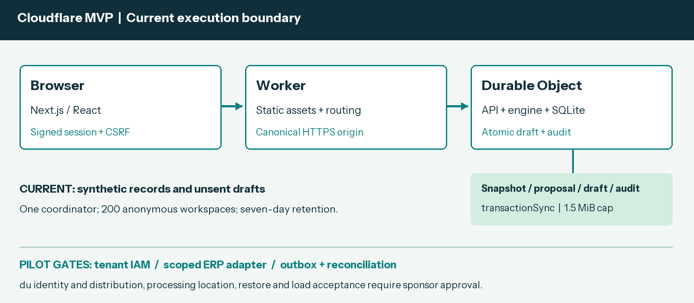

# Aqion Relay system design

Updated 16 October 2026. Brand: aqionlabs.ai.

- [Live MVP](https://duignytemvp.aqionlabs.workers.dev)
- [GitHub repository](https://github.com/Jaferdecodesai/DuIgnyteMVP_Aqionlabs)
- [Editable architecture DOCX](Aqion-Relay-System-Design.docx)
- [Architecture PDF](Aqion-Relay-System-Design.pdf)
- [Pitch deck](Aqion-Relay-Du-Ignyte-Pitch.pdf)

Aqion Relay System Design

Cloudflare MVP and pilot integration

16 October 2026  |  ResilienceTech  |  aqionlabs.ai

This document updates the supplied system design to the current mobile web implementation. It describes the deployed execution boundary, API contracts, approval integrity and release operations, then identifies the integration and scale gates for a proposed du SME pilot.

| Status | Current scope |
| --- | --- |
| MVP implementation | Next.js frontend, native Cloudflare Worker API and SQLite-backed Durable Object |
| Data and actions | Fictional SME records; owner-approved unsent drafts; no supplier or payment transmission |
| Product and engineering | aqionlabs.ai; sponsor security, integration and pilot roles to be appointed |
| Pilot proposal | 160 consenting SMEs in four waves; minimum 150 enrolled before intervention |

The repository README provides direct access to the live MVP, pitch formats and architecture formats. Current release evidence is kept with the source; targets and planned integrations are distinguished from verified implementation.

## 1 Abstract

Aqion Relay is a ResilienceTech decision workbench for UAE non-perishable goods distributors. It compares supply recovery purchases against an owner-set operating cash floor and fictional approved-supplier constraints. The implemented web MVP uses a numerical forecast, a 30-day stock and scheduled-cash simulation, and explicit owner review before saving an unsent draft.

The public deployment serves a Next.js static export through Cloudflare Worker assets. Its API, engine and domain service execute inside a native SQLite-backed Durable Object. The prototype scope remains one SKU per SME and three fictional SMEs. ERP connections, generative narration, authenticated business tenants and du distribution enter through the pilot roadmap.

## 2 Goals and non goals

| Goals | Non goals |
| --- | --- |
| Compare recovery choices with daily cash and service impact | Guarantee actual cash, supplier delivery or a global optimum |
| Keep source-bound human review and durable audit evidence | Send purchases, move funds or replace an ERP |
| Test 40% shorter planning time in controlled pilot drills | Claim achieved customer benefits or completed recruitment |
| Provide digital integration and a gated 40,000-SME scale path | Assert the capped demo already supports enterprise scale |

## 3 Background and problem statement

A shipment delay threatens customer fulfilment while a replacement purchase competes with payroll, rent and other cash obligations. Relay focuses on that decision alongside existing inventory tools: read a versioned operational snapshot, stress-test a disruption, compare feasible alternatives, and retain the reviewed evidence.

The reference synthetic packaging case evaluates 130 combinations. A 400-unit Oasis recovery purchase costs AED 7,887.50 and serves 1,362 projected units versus 990 without recovery. Minimum projected cash is AED 28,112.50 against an AED 24,000 floor. These are reproducible fictional model outputs, not customer outcomes.

## 4 Current architecture and pilot extension

| Component | Responsibility | Persistence and failure behavior |
| --- | --- | --- |
| Next.js and React | Responsive Overview, Evidence, Connections and Pilot views | Static assets; retry UI on API failure; no client-selected workspace key |
| Worker router | Canonical origin, security headers, static assets and API allowlist | Forward intact Request to one stable coordinator; reject unknown API paths |
| Durable Object API | Signed anonymous session, input validation and domain actions | Native SQLite; transactionSync encloses read, checks, mutation, encode and commit |
| Forecast and simulator | Ridge weekday/trend versus seasonal naive; bounded candidate enumeration | Label sparse-history fallback; maintain baseline and cash-floor checks |
| Approval service | Recheck source/calculation versions and explicit confirmation | One outstanding draft per SME; atomic draft and audit; idempotent repeat |
| Pilot connectors | Consented ERP reads, approved draft writes and du interfaces | Proposed scoped adapters, outbox, reconciliation and tenant IAM |

The singleton uses idFromName("relay-demo-v1"). Demo bounds are 200 anonymous workspaces, seven-day expiry, 1.5 MiB per document, 100 undrafted proposals plus referenced drafts, and 200 drafts/audit events per SME. Expired workspace cleanup is opportunistic during creation. Pilot scale requires partitioned authenticated tenant/SME storage and separate acceptance tests.

## 5 Request lifecycle

1. GET /api/state issues or verifies a signed anonymous session and returns the selected fictional SME plus a CSRF token.

2. The browser POSTs JSON with the canonical Origin, session cookie and X-Relay-CSRF. Inputs are bounded to 256 KiB.

3. The engine validates source age and supplier terms, fits a forecast, and evaluates 30-day stock and scheduled cash under the scenario.

4. The owner compares alternatives, opens the review dialog, checks quantities and cash floor, then explicitly confirms an unsent draft.

5. Approval rechecks the current source digest, calculation hash, proposal expiry, plan eligibility and outstanding-draft invariant in one synchronous SQL transaction.

6. The service persists the draft and its audit entry together. An identical retry returns the same draft, including canceled status.

7. Evidence can be exported, a draft canceled, or a confirmed fictional snapshot reset. Imports invalidate prior source-bound proposals.

## 6 API and data contracts

| Method and route | Contract |
| --- | --- |
| GET state / export | tenant=packaging, trading or homeware; signed browser session; export contains no session or CSRF secret |
| POST simulate | tenant and bounded delay, demand, freight and cash_floor; returns source/version-bound proposal and plans |
| POST approve / cancel | proposal_id, plan_id and confirm=true for approval; draft_id for cancellation |
| POST import / reset | Complete tenant-matched snapshot with synthetic=true; reset requires confirm=true |
| GET health | Native storage readiness, synthetic mode and writes flag; no credentials or private identifiers |
| POST access / logout | Optional shared demo gate and cookie clearing; gate does not provide enterprise identity |

The /api/ prefix is explicit: unknown or nested actions return JSON 404 and unsupported methods return 405. The authoritative contract is docs/WEB_API.md; TypeScript shapes are in src/lib/types.ts. A snapshot includes stock, scheduled receipts/obligations, history, prepaid inbound stock, approved suppliers, quote validity and modeled age. Proposal lifetime is 30 minutes.

## 7 Consistency idempotency and replay

Native SQLite transactionSync performs the workspace read, domain checks, mutation, document-size check and persisted write synchronously. A thrown validation or storage error rolls back both draft and audit. The transaction prevents simultaneous requests from creating two outstanding drafts. An identical approval returns its existing result; a canceled draft is not resurrected.

Proposal identity binds the snapshot digest, scenario and calculation versions. An import changes the source revision, and approval recomputes the result before accepting the reviewed plan. Stale source data, expired supplier terms, elapsed proposal lifetime, an infeasible or fabricated plan, and an existing outstanding draft reject approval.

These guarantees apply to the unsent demo draft. An enterprise write requires a reservation and transactional outbox, a provider idempotency strategy, event/revision tracking and reconciliation. Ambiguous ERP results remain pending reconciliation; a blind retry must not create a second external order.

## 8 Security and privacy considerations

Current sessions: HMAC-signed anonymous browser cookie; HttpOnly, SameSite=Strict, Secure on HTTPS; seven-day lifetime. This isolates fictional workspaces but is not tenant IAM.

Current request controls: exact canonical HTTPS origin/Host, same-origin mutation checks, HMAC CSRF, bounded JSON, strict validation and safe error messages. Security headers apply to assets and API responses.

Current secrets: the stable signing secret is a Cloudflare Worker secret. Local .env, .dev.vars, storage, OAuth credentials and persistence-probe cookies are excluded from public source and static asset uploads.

Current writes: RELAY_WRITES_ENABLED controls demo mutations. Enabled actions save fictional state only. Per-session rate limits are best effort per running coordinator instance, not a distributed attack-control claim.

Pilot access: authenticate business users, authorize every tenant object/job/export, use scoped connector credentials and redact telemetry. Keep operational records out of cross-SME prompts and analysis.

Pilot processing: agree data roles, location, retention and deletion; test encryption, restore, incident ownership and audited write-pausing. Global edge deployment does not by itself establish UAE data residency.

## 9 Operational readiness and release controls

The release process is source review, locked dependency install, strict type checks, regression tests and coverage, Node build, Next.js static export, Worker dry run, native local smoke, owner-authorized deployment and public verification. GitHub Actions runs build/test/audit gates on pushes. Cloudflare production deployment remains an explicit release action; no stored CI cloud credential is introduced.

| Gate | Acceptance evidence |
| --- | --- |
| Code and dependencies | 127 regression tests and configured coverage thresholds; production/static builds; zero moderate-or-higher audit findings |
| Native runtime | Actual workerd and HTTPS API checks for sessions, routing, calculations, CSRF, isolation, imports and concurrent approvals |
| Persistence and assets | Retain draft plus audit across same-namespace redeploy; downloaded presentation/document bytes match release SHA-256 |
| Browser and documents | Scenario and owner review; responsive layout; links and all final slides/pages rendered and inspected |
| Pilot service targets | Proposed 99.9% availability, p95 scenario <5 s, RPO <=15 min and RTO <=4 h; sponsor agreement and separate acceptance required |

Routine updates retain Worker name, Durable Object class/namespace, stable idFromName value and signing secret. The requested hostname is a new named deployment and starts a separate anonymous demo workspace. To pause mutations set RELAY_WRITES_ENABLED=false and redeploy. For a failed code release select a verified prior version with wrangler rollback; code rollback does not undo persisted state. Never delete the namespace as a routine update.

## 10 Alternatives considered

| Alternative | Decision |
| --- | --- |
| Static frontend only | Rejected: server authority, durable approvals and audit must execute on the server |
| Node plus MySQL hosting | Optional adapter retained; Cloudflare native SQLite is the deployed target |
| Full micro ERP or liquidity marketplace | Deferred: migration or counterparty/legal scope exceeds the first recovery decision |
| LLM decides quantities or autonomous buying | Rejected for the MVP: numerical constraints and owner authority control each draft |

## 11 Integration decisions before the pilot

Confirm the du sponsor and technical owners, consenting SME recruitment, supported ERP organization/region and OAuth scopes, processing/privacy requirements, support ownership and cost ceiling. Screen source completeness and approved alternative supplier terms before admitting an SME to intervention. No du, ERP, banking or supplier interface is claimed connected.

## 12 Integration roadmap and pilot execution

| Phase | Delivery and acceptance gate |
| --- | --- |
| Weeks 1 to 2 | Map consented snapshots, source IDs and supplier terms; approve scope and processing/security design |
| Weeks 3 to 4 | Zoho read-only adapter; normalized stock, sales and scheduled-cash mapping; reconcile source totals and revisions |
| Weeks 5 to 6 | Owner-authorized ERP drafts, outbox and idempotency; sandbox ambiguity, retry, authorization and restore tests |
| Weeks 7 to 8 | Agreed du interfaces, monitoring and support; named sponsor acceptance before pilot comparison |

Proposed enrollment is 160 consenting non-perishable-goods SMEs, with at least 150 enrolled before intervention. Four waves of 40 begin in pilot weeks 1, 2, 3 and 4. Each receives two baseline weeks and six comparison weeks. Within each wave and sector/size/ERP strata, randomize 20 immediate-access and 20 delayed-access SMEs. The last comparison ends in week 11 and analysis occurs in week 12. Do not replace randomized dropouts.

Prospective targets are 40% shorter time to an owner-approved feasible plan, 90% rubric-passing plans across assigned drills, and 70% weekly workflow use among SMEs with access. Pre-register the analysis, complete power/MDE work before intervention, and report effects, uncertainty, attrition and deviations. Stop on a projected floor breach, unauthorized external write or duplicate external effect.

Scale from the accepted pilot to a controlled 1,000-SME rollout, then the 40,000+ ambition only after isolation, peak-load, unit-cost and recovery acceptance. Use authenticated tenant/SME partitioning, queues, shared limits and observability. The 200-workspace singleton demo is not evidence of that capacity.

This design records implemented behavior and a proposed pilot. Portal registration, final upload and a submission receipt remain owner actions; no submitted entry or organizer approval is asserted.
